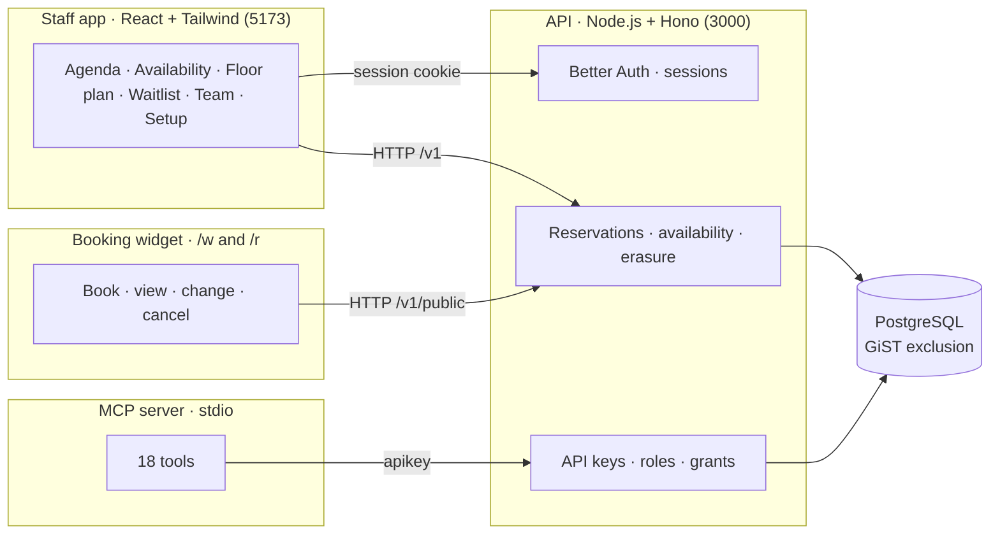
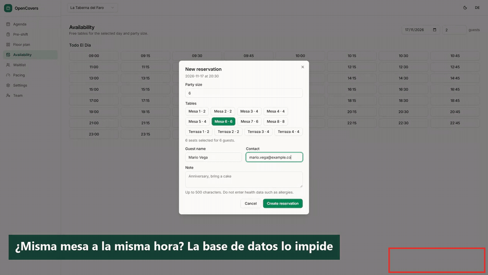
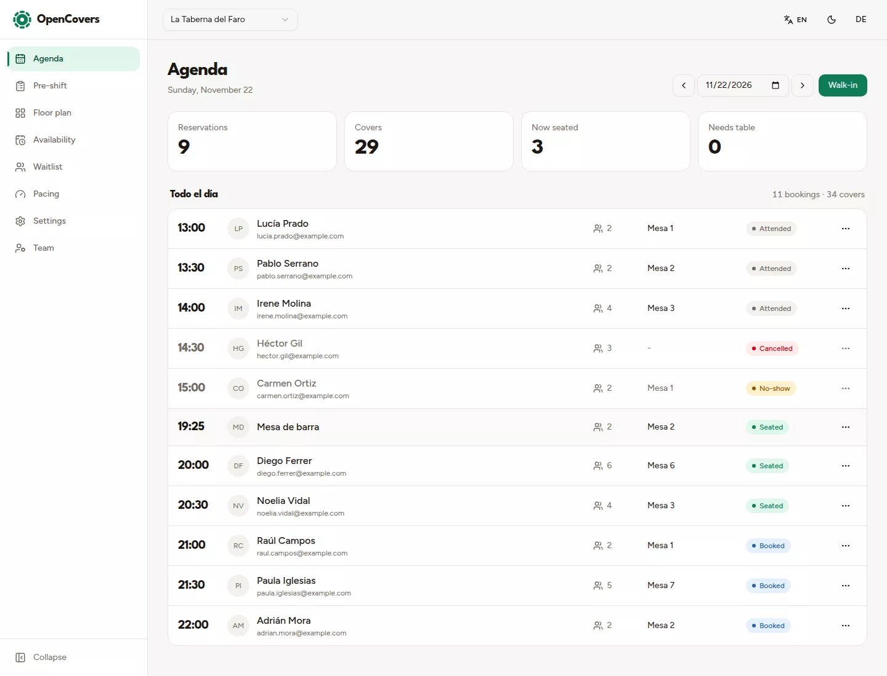
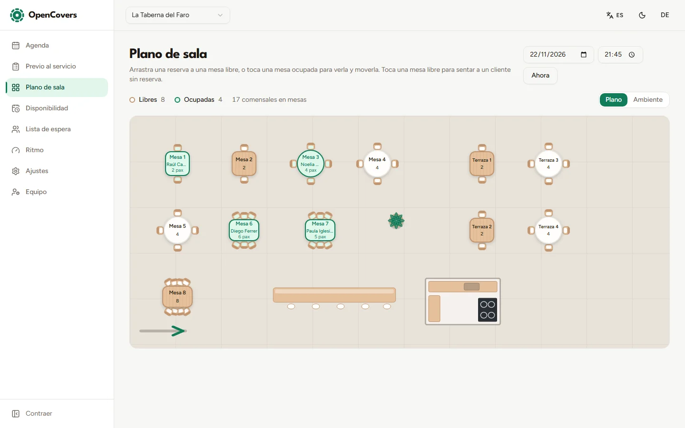
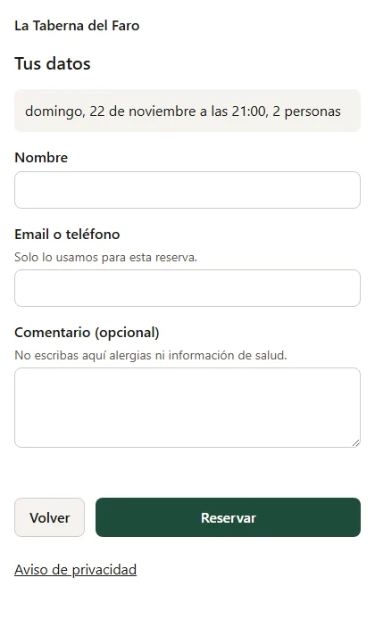

<div align="center">


# OpenCovers

**The open-source reservations engine for restaurants — availability, bookings, tables, and the event feed, with an API and an MCP server.**

<sub>Pre-alpha: it runs locally with tests and is not ready for a real venue. Public site: <a href="https://opencovers.dev">opencovers.dev</a>. A hosted demo, a sandbox with invented data, is open at <a href="https://demo.opencovers.dev">demo.opencovers.dev</a>.</sub>


[](https://www.npmjs.com/package/@opencovers/mcp)


[](LICENSE)


</div>

---

## Why

Most booking systems are tied to a CRM, a point-of-sale system, or a single vendor. A venue that changes its front end or its messaging provider risks losing its reservation book.

OpenCovers keeps the book independent. Any platform or AI agent reads availability, creates a booking, modifies it, or cancels it through the same contract — and the no-double-booking rule is enforced by the database, not by application code.

## Features

### 📅 Availability and booking

Read free time slots per service, create a booking against specific tables, and move, cancel, or seat it. Every write carries an idempotency key and a monotonic version.

### 🚫 No double bookings, guaranteed

A GiST exclusion constraint in PostgreSQL rejects overlapping table allocations. It holds for any number of concurrent writers — no application-level locking.

### 🔑 Humans and machines, both first-class

Staff sign in with Better Auth and get a per-venue role. Platforms and AI agents use scoped API keys (`read`/`write`) that a venue admin mints and revokes from the staff app.

### 🎛️ Control of the room and the book

An explicit overbooking ceiling per venue (default 0, enforced under a per-venue lock), a booking note of up to 500 characters, a reconfirmation status on each reservation, and a rule that a reservation cannot be seated without a table. An optional booking policy per venue limits how far ahead a guest can book, caps one guest's active bookings per day, and blocks dates. Each service runs on the weekdays you choose. The staff app has a pre-shift view for a service and date, and an endpoint explains why a slot is closed.

### 👥 Staff access you control

A venue admin invites staff, changes their roles, and removes members from the staff app, with the roles `read`, `write`, and `admin` applied to keys and sessions. Removing a member revokes the keys they made for the venue, and their sessions when they belong to no other venue. The Team screen shows an audit log of these changes. Sign-up is controlled with the `SIGNUP` setting, only the owner creates venues on closed instances, and sign-in, sign-up and invitation redemption are rate limited.

### 🤖 An MCP server

The 18-tool catalog (`reservation.*`, `waitlist.*`, `venue.*`) is exposed over stdio, so Claude, Cursor, and other MCP hosts can operate a venue directly. It is published on npm as [`@opencovers/mcp`](https://www.npmjs.com/package/@opencovers/mcp) and listed in the official MCP registry as `io.github.David-Cabeza/opencovers`. Run it with `npx -y @opencovers/mcp`. Every reservation and waitlist write tool except `reservation.erasure` takes an optional idempotency key. An agent that retries after a timeout sends the same key and does not book twice. A call without a key is a new write, so the server generates a fresh key for it. A repeated erasure erases nothing more. Each error tells the agent whether a retry can succeed. OAuth 2.1 authorization server behind `MCP_REMOTE`, off by default, part 1 of the remote MCP work (issue #67); no `/mcp` endpoint yet.

### 🧭 The room, covered

Walk-ins, a waitlist, zones, and automatic table assignment. The engine seats guests now, holds them in a queue, and assigns tables so platforms and agents never think about floor plans. A waitlist entry is seated once, even when two requests try to seat it at the same time. The API also lets a guest join, read and leave a venue's waitlist through public routes. The widget has a join form for a full day and a page at `/r/waitlist` to read and leave the entry. Both are off by default, their wording is provisional pending legal review, and they were tested with fakes and jsdom, not end to end in a browser.

### 🙋 Guests

The engine keeps one guest record per venue, matched by normalized email or phone. The API lists and reads guests, and an admin merges and unmerges them with an audit trail. Through the API, an admin can also block a contact. The blocklist stores a keyed hash of the contact, and a new booking from that contact is refused with `booking_declined`. There is no guest screen in the staff app yet.

The staff app speaks Spanish and English, with light and dark themes. A selector in the top bar (and on the sign-in screen) changes the language and the choice is kept in the browser; the first time it uses the browser's language when it is one of the two, and Spanish otherwise. The texts live in one catalog per area under `apps/web/src/i18n/`, see its README for how to add one.

### 🌐 Online booking (in progress)

A venue can take bookings on its own website ([ADR-0017](docs/adr/0017-booking-widget-and-self-service-link.md)). In **Setup → Online booking**, an admin turns it on, sets the online limits and the allowed sites, and copies an `<iframe>` snippet. The widget at `/w/{bookingKey}` books through public routes under `/v1/public` that need no account, with a proof-of-work challenge and rate limits. After booking, the guest gets a private link to a page at `/r` that shows the booking and lets them change the party size or the note, or cancel. The same card sets the page's colors, corner radius, font and logo, with a preview, and warns after a save when the text is hard to read against the background. Parts not built yet include the link in the confirmation email, the consent question, and an optional CAPTCHA. The widget shows a strip of days with a status for each (available, full or closed), lets the guest choose a zone, and shows a summary before it asks for the guest's details. It speaks seven languages (Spanish, English, Catalan, French, German, Italian and Portuguese), taken from a `?lang=` on the address, the host page's language that `embed.js` passes, or the venue's language. It stays light unless the embed asks for more: `data-scheme="auto"` on the `embed.js` tag lets it follow the visitor's light or dark setting, and a venue can set a dark palette (colors, radius and font) in the same theme. A venue can also publish an opt-in public profile as schema.org Restaurant JSON-LD for its own pages.

### 🪑 A visual floor plan

Drag tables and room elements onto a floor, snap them to a grid, rotate them, and resize them. Tables come in round, oval, square, rectangle, and long (banquet) shapes with chairs; room elements (bar, kitchen, wall, window, door, plant, large plant, counter, entrance, sofa, column, stairs, rug, umbrella, host stand, banquette, planter, fireplace, wine rack, restroom) are drawn as architectural symbols on a wood floor — so the plan reads like a plan, not a list.

### 🔎 Where a booking came from

Every reservation event records which channel made the change (`widget`, `staff`, `api` or `mcp`) and a stable, non-personal actor reference, so the MCP server is told apart from any other API key and a later cancellation shows its own actor ([ADR-0023](docs/adr/0023-event-channel-and-actor.md)). The staff app shows it as a trace in the reservation dialog, and `GET /v1/venues/{venueId}/reservations/{reservationId}/trace` returns the same entries.

### 📧 Guest emails

Through Resend, a guest gets an email when a booking is confirmed, changed or cancelled (by the guest or by the venue), and when they ask for a new self-service link. The venue gets a notice of each new booking. Booking emails go out once per reservation version, never duplicated. The confirmation, change and cancellation emails carry a calendar file. Each email shows the venue's logo and its primary colors, and falls back to the OpenCovers colors when the venue's pair is hard to read. The text follows the guest's booking language, then the venue's, and only the Spanish catalog ships so far ([ADR-0024](docs/adr/0024-guest-email-language.md)). A venue uses its own Resend account or the instance's, and email is off until the venue turns it on. Joining the public waitlist also sends the guest an email with a link to leave it, when the venue has email on (provisional text). The email text is a placeholder pending legal review.

### 🔔 Signed webhooks

Register an HTTPS endpoint and the engine pushes every reservation event to it: created, modified, cancelled, seated, attended, no_show, and erased. Each POST is signed with HMAC-SHA256, arrives in order, and is retried with backoff until acknowledged. Private and metadata addresses are refused. See [docs/contract/webhooks.md](docs/contract/webhooks.md).

### 🧹 Erasure built in

An admin erases a guest's data by guest record or by principal, and gets back counts. Tombstones keep the hashes, never the personal values. An hourly job erases guest data past the venue's retention period.

## How it works



## Quick start

You need Node.js 22.9 or newer, pnpm, and Docker.

```sh
git clone https://github.com/David-Cabeza/OpenCovers.git
cd OpenCovers
docker compose up -d   # PostgreSQL
pnpm install
pnpm db:migrate
pnpm dev               # API :3000 · staff app :5173 · site :5174
```

Open <http://localhost:5173>, sign up, and create a venue. The public site is at <http://localhost:5174>. The full guide is in [CONTRIBUTING.md](CONTRIBUTING.md).

To run the MCP server, use `npx -y @opencovers/mcp` or see [apps/mcp](apps/mcp/README.md). Create an agent key from the staff app under **Setup → API keys**.

## Setting up on a new machine

Exact steps from a clean machine to a running stack. Intended layout: Ubuntu on WSL2, macOS, or any Linux. It has been exercised on macOS and, in a smoke test, on Ubuntu under WSL2 (Node 26.13.1, newer than the pinned 22 line; install, migrate, typecheck, tests and `pnpm dev` all passed). Work inside the Linux file system (for WSL2, `~/projects`, not `/mnt/c`).

1. **Prerequisites**: git, Docker (Docker Desktop with WSL integration, or Docker Engine), and Node.js 22.9 or newer through [nvm](https://github.com/nvm-sh/nvm).
2. **Clone** (SSH):
   ```sh
   mkdir -p ~/projects && cd ~/projects
   git clone git@github.com:David-Cabeza/OpenCovers.git
   cd OpenCovers
   ```
3. **Node and pnpm**: `.nvmrc` pins the Node 22 line (22.9 or newer is required) and `packageManager` pins pnpm.
   ```sh
   nvm install        # reads .nvmrc
   nvm use
   corepack enable    # activates the pinned pnpm
   # If corepack cannot fetch it: npm install -g pnpm@11.0.9
   ```
4. **Install and start the database**:
   ```sh
   pnpm install --frozen-lockfile
   docker compose up -d     # PostgreSQL 16 on :5432 (opencovers + opencovers_test)
   pnpm db:migrate
   ```
5. **Check it works**:
   ```sh
   pnpm typecheck
   pnpm test
   pnpm build
   pnpm dev                 # API :3000 · staff app :5173 · site :5174
   ```
6. **Environment**: none is needed locally. To override a default, `cp .env.example .env` and uncomment only what you change. Never commit `.env`.

Notes: use `git config core.autocrlf input` only if you also edit on Windows outside WSL (the repo already normalizes to LF). A fresh machine starts with an empty database, so create a new venue after signing up, or load a ready-made demo venue with `pnpm demo:seed` (see Demo data below). The brand kit in `docs/brand` needs Chrome or Chromium only if you regenerate it.

## Demo data

To record a video or try the staff app with a believable venue, start the stack and seed a fresh database:

```sh
pnpm db:migrate
pnpm dev                 # in one terminal
pnpm demo:seed           # in another
```

It creates the invented venue "La Taberna del Faro" through the HTTP API: two services, 12 tables in two zones with a floor plan, online booking, a public profile, about 25 reservations across today and the next three days (some seated, attended, no-show, cancelled or modified), a waitlist, a second team member (role `write`) and a pending invitation, a read key, a write key, a self-service link and an MCP host config. It prints the sign-ins (`demo@opencovers.test` and the second member, local-only demo passwords), the booking widget URL and the keys. All guests are invented and use `example.com` addresses. Run it once per account: it stops with a message if the account already has a venue named "La Taberna del Faro". The API generates the venue id and the script prints it. `ALLDAY=1 pnpm demo:seed` uses one service from 09:00 to 23:45 so walk-ins work at any hour. It refuses `NODE_ENV=production` and any non-local `BASE`. For a thin venue on an account you already have, use `pnpm db:seed-demo <email>`.

## Demo

The GIF shows the engine refusing a second booking of the same table. The MP4 is a 30-second walkthrough in Spanish: the agenda, a booking from the widget, the same refusal in the staff app, and an MCP client hitting the same rule. The MCP scene is the real output of an `@opencovers/mcp` run, replayed in an animated terminal window, not a screen recording.

<p align="center">
  
</p>

> [Download the full-resolution demo (MP4)](https://raw.githubusercontent.com/David-Cabeza/OpenCovers/main/docs/assets/opencovers-demo.mp4)

For a restaurant owner, an 80-second video of one service (Spanish captions): the pre-service view, the floor plan, the waitlist, a booking from the widget, the online booking settings with a live preview, the booking history and the floor editor. The self-service link is blurred. [Download the MP4](https://raw.githubusercontent.com/David-Cabeza/OpenCovers/main/docs/assets/opencovers-servicio.mp4)

For developers and agents, a 90-second video (Spanish captions with an English line): creating an API key in the staff app, the MCP host configuration, a booking made by an MCP client, the refusal with `slot_taken`, a retry with the same idempotency key that returns the same booking, the channel recorded in the booking history and the event feed. The terminal windows are the real output of an `@opencovers/mcp` run, replayed, and the API key is blurred. [Download the MP4](https://raw.githubusercontent.com/David-Cabeza/OpenCovers/main/docs/assets/opencovers-desarrolladores.mp4)

## Screenshots

The staff app in action: the agenda, the floor plan, the floor editor, the waitlist, the online booking settings and the team screen. All screens show the invented demo venue "La Taberna del Faro" (`pnpm demo:seed`), running locally.

<p align="center">
  
  
</p>
<p align="center">
  
</p>
<p align="center">
  
</p>
<p align="center">
  
</p>
<p align="center">
  
</p>

The guest-facing pages, in Spanish because the demo venue is configured in Spanish. The booking widget and the self-service page are still in progress, so treat them as a preview.

<p align="center">
  
  
</p>

## Repository layout

```
apps/api     the reservation engine and the HTTP API
apps/web     the staff app
apps/widget  the guest booking widget and self-service page, served by the API at /w/{bookingKey} and /r
apps/mcp     the MCP server
apps/site    the public website
docs/        the contract, ADRs, and requirements
```

## Design rules

- One transaction decides availability and booking.
- The database enforces the no-overlap rule. Application code does not.
- Every write carries an idempotency key and produces a monotonic version.
- A venue's data is isolated. A request for another venue returns not found.
- The engine takes a booking and honors a STOP without a memory platform.
- The engine stores the minimum guest data a booking needs.
- Erasure returns counts and keeps hashes, not personal values.
- The contract and the conformance cases come before the implementation.

## Hosted demo

A hosted demo is open to the public at [demo.opencovers.dev](https://demo.opencovers.dev), with its [terms of use](https://opencovers.dev/condiciones.html) and [privacy notice](https://opencovers.dev/privacidad.html). With `DEMO_MODE=1` one deployment becomes a public demo where each visitor signs in with an emailed magic link (after a proof-of-work challenge) or with Google, and gets a sandbox restaurant of their own, with caps on what it can hold and a sandbox bar and guided tour in the staff app. The terms and the privacy notice were written without a lawyer's review, and a sandbox is deleted after 14 days without a sign-in. It runs on its own host and database, never next to real data, and it is off by default. See [ADR-0022](docs/adr/0022-hosted-demo-sandbox.md) and the [deploy guide](docs/deploy.md#hosted-demo). The public site links to it from the hero.

## Deploy

OpenCovers has no hosting vendor dependency. It needs PostgreSQL and a Node.js process. The API ships as a Docker image, and the staff app is a static build that any web server can serve. Whoever forks it for a venue decides where the database lives. The project's own site is on GitHub Pages at [opencovers.dev](https://opencovers.dev). See [docs/deploy.md](docs/deploy.md). Self-hosters should also read the [hardening guide](docs/hardening.md).

## Status

Pre-alpha. The engine, the staff screens, and the MCP server are implemented and tested locally. Of the 78 conformance cases, 70 pass and 8 are partial (C43 to C45, C50, C51, C55, C67 and C70), signed webhooks included. None is a gap. 17 cases (C39 to C55) specify the booking widget and self-service link: 11 pass and 6 are partial (C43 to C45, C50, C51 and C55). Stages 2 to 7, 9, 10, 12 and 15 of ADR-0017 are built. They are the online booking settings, the public booking API for config, availability and create, the guest self-service link to read, change and cancel a booking, the booking widget with its framed page, the guest's self-service page, the Online booking card in Setup, the venue's theme (colors, corner radius, font and logo) in the widget and in Setup, the `embed.js` script that sizes the iframe and passes the host page's language, a "lost your link?" form that emails a new link when the venue has email on (placeholder email text), and the widget in seven languages, five of them machine-assisted and waiting for native review. Stages 8, 11 and 13 wait on a legal review or an optional CAPTCHA, and stage 14 is deferred. ADR-0021 adds the day strip, the zone choice and the summary step to the widget. Its public waitlist is built in the API (C68 to C78: join, read, leave and the join email, migration 0047), and its widget join (on a full day, with an unticked consent box) and the `/r/waitlist` page are built too (stage 12). They are off by default, the wording is provisional pending legal review, C70 stays partial, and the hosted demo does not turn it on. A production deployment is prepared (Dockerfile, a Compose stack behind Caddy with security headers and health checks, and a runbook), and the same images run the [hosted demo](#hosted-demo), which is open to the public. Its terms of use and privacy notice were drafted without a lawyer's review. Do not rely on OpenCovers for a real venue's bookings yet. Email delivery is wired via Resend; the templates' legal text and consent basis are still pending review. See [ROADMAP.md](ROADMAP.md).

## Contributing

OpenCovers uses flags — scoped tasks with acceptance criteria, dependencies, and a size. Anyone can propose or claim one. Read [CONTRIBUTING.md](CONTRIBUTING.md) and the [flag issue form](.github/ISSUE_TEMPLATE/flag.yml). Small tasks for newcomers carry the [good first issue](https://github.com/David-Cabeza/OpenCovers/labels/good%20first%20issue) label. Most of the code here is written by AI agents under the maintainer's review. An agent may contribute too, as long as the pull request says so (see [docs/collaboration-security.md](docs/collaboration-security.md)).

## Governance and security

- [GOVERNANCE.md](GOVERNANCE.md) explains how decisions are made.
- [SECURITY.md](SECURITY.md) explains how to report a vulnerability.
- [docs/collaboration-security.md](docs/collaboration-security.md) sets the rules for contributions, dependencies, and AI agents.
- [CODE_OF_CONDUCT.md](CODE_OF_CONDUCT.md) applies to every project space.

## License

Apache-2.0. See [LICENSE](LICENSE).
