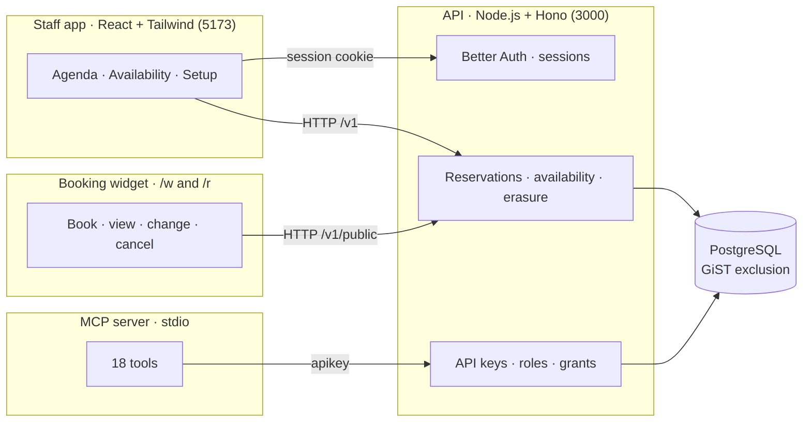
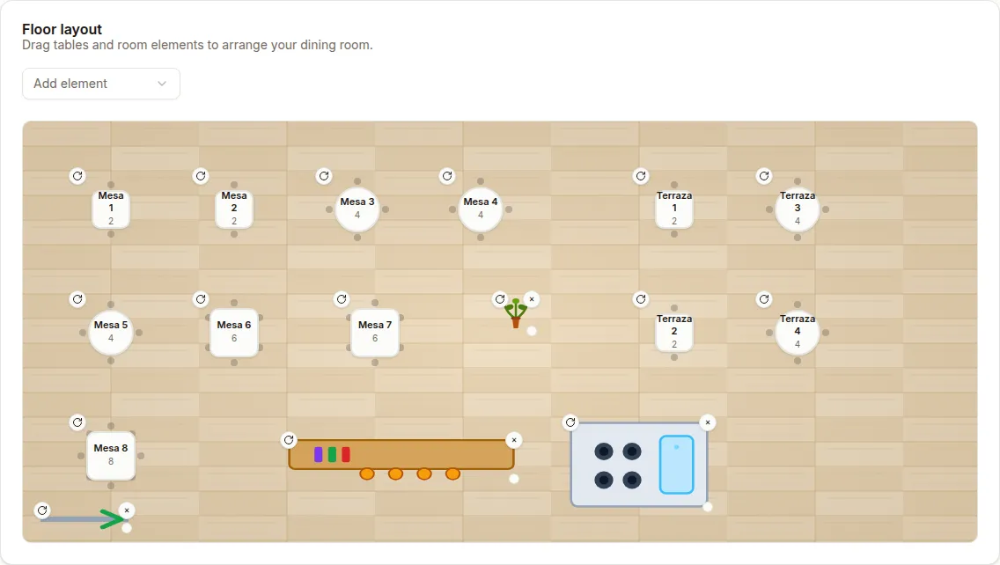
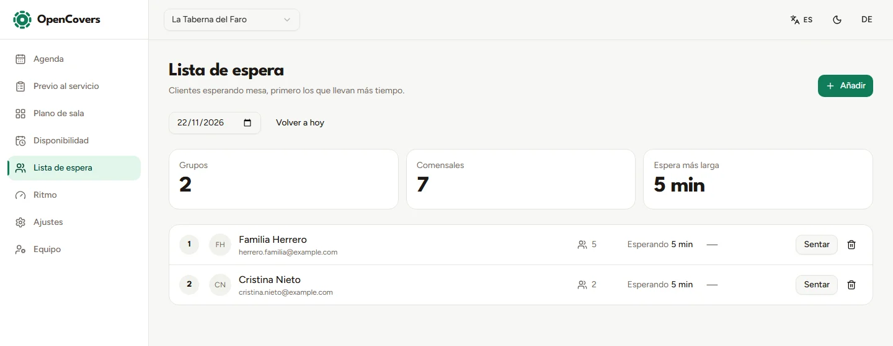
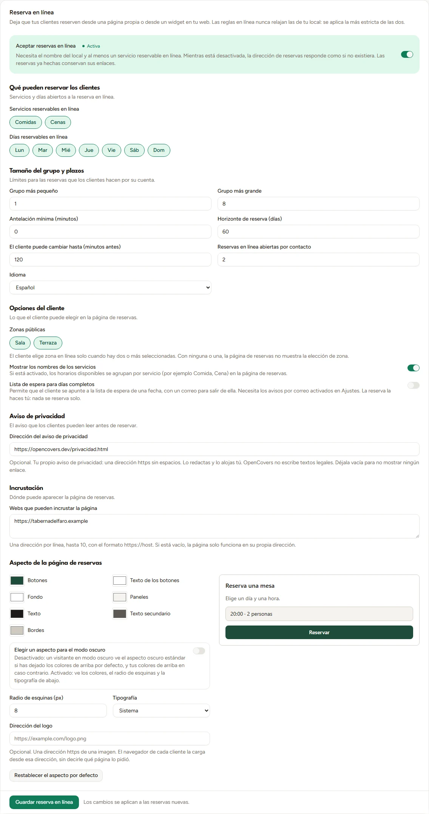
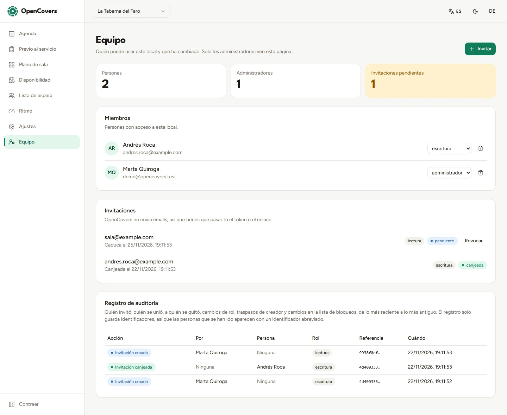
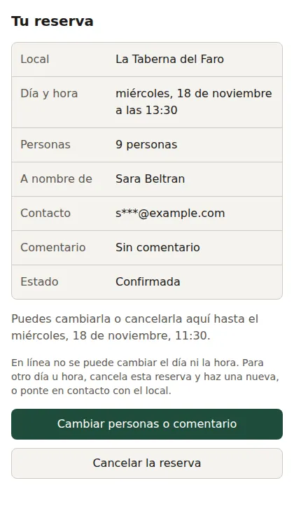

<div align="center">


# OpenCovers

**The open-source reservations engine for restaurants — availability, bookings, tables, and the event feed, with an API and an MCP server.**

<sub>Pre-alpha: it runs locally with tests, nothing is deployed yet. Public site: <a href="https://opencovers.dev">opencovers.dev</a>.</sub>


[](https://www.npmjs.com/package/@opencovers/mcp)


[](LICENSE)


</div>

---

## Why

Most booking systems are tied to a CRM, a point-of-sale system, or a single vendor. A venue that changes its front end or its messaging provider risks losing its reservation book.

OpenCovers keeps the book independent. Any platform or AI agent reads availability, creates a booking, modifies it, or cancels it through the same contract — and the no-double-booking rule is enforced by the database, not by application code.

## Features

### 📅 Availability and booking

Read free time slots per service, create a booking against specific tables, and move, cancel, or seat it. Every write carries an idempotency key and a monotonic version.

### 🚫 No double bookings, guaranteed

A GiST exclusion constraint in PostgreSQL rejects overlapping table allocations. It holds for any number of concurrent writers — no application-level locking.

### 🔑 Humans and machines, both first-class

Staff sign in with Better Auth and get a per-venue role. Platforms and AI agents use scoped API keys (`read`/`write`) that a venue admin mints and revokes from the staff app.

### 🎛️ Control of the room and the book

An explicit overbooking ceiling per venue (default 0, enforced under a per-venue lock), a booking note of up to 500 characters, a reconfirmation status on each reservation, and a rule that a reservation cannot be seated without a table. An optional booking policy per venue limits how far ahead a guest can book, caps one guest's active bookings per day, and blocks dates. Each service runs on the weekdays you choose. The staff app has a pre-shift view for a service and date, and an endpoint explains why a slot is closed.

### 👥 Staff access you control

A venue admin invites staff, changes their roles, and removes members from the staff app, with the roles `read`, `write`, and `admin` applied to keys and sessions. Removing a member revokes the keys they made for the venue, and their sessions when they belong to no other venue. The Team screen shows an audit log of these changes. Sign-up is controlled with the `SIGNUP` setting, only the owner creates venues on closed instances, and sign-in, sign-up and invitation redemption are rate limited.

### 🤖 An MCP server

The 18-tool catalog (`reservation.*`, `waitlist.*`, `venue.*`) is exposed over stdio, so Claude, Cursor, and other MCP hosts can operate a venue directly. It is published on npm as [`@opencovers/mcp`](https://www.npmjs.com/package/@opencovers/mcp) and listed in the official MCP registry as `io.github.David-Cabeza/opencovers`. Run it with `npx -y @opencovers/mcp`. Every reservation and waitlist write tool except `reservation.erasure` takes an idempotency key, so an agent that retries after a timeout does not book twice. A repeated erasure erases nothing more. Each error tells the agent whether a retry can succeed.

### 🧭 The room, covered

Walk-ins, a waitlist, zones, and automatic table assignment. The engine seats guests now, holds them in a queue, and assigns tables so platforms and agents never think about floor plans. A waitlist entry is seated once, even when two requests try to seat it at the same time.

### 🙋 Guests

The engine keeps one guest record per venue, matched by normalized email or phone. The API lists and reads guests, and an admin merges and unmerges them with an audit trail. Through the API, an admin can also block a contact. The blocklist stores a keyed hash of the contact, and a new booking from that contact is refused with `booking_declined`. There is no guest screen in the staff app yet.

### 🌐 Online booking (in progress)

A venue can take bookings on its own website ([ADR-0017](docs/adr/0017-booking-widget-and-self-service-link.md)). In **Setup → Online booking**, an admin turns it on, sets the online limits and the allowed sites, and copies an `<iframe>` snippet. The widget at `/w/{bookingKey}` books through public routes under `/v1/public` that need no account, with a proof-of-work challenge and rate limits. After booking, the guest gets a private link to a page at `/r` that shows the booking and lets them change the party size or the note, or cancel. The same card sets the page's colors, corner radius, font and logo, with a preview, and warns after a save when the text is hard to read against the background. Parts not built yet include the link in the confirmation email, the consent question, and an optional CAPTCHA. A venue can also publish an opt-in public profile as schema.org Restaurant JSON-LD for its own pages.

### 🪑 A visual floor plan

Drag tables and room elements onto a floor, snap them to a grid, rotate them, and resize them. Tables come in round, square, and rectangle shapes with chairs; room elements (bar, kitchen, wall, window, door, plant, counter, entrance) are drawn as architectural symbols on a wood floor — so the plan reads like a plan, not a list.

### 📧 Email confirmations

Confirmations, cancellations, and booking notices via Resend — one per reservation version, never duplicated. Each venue brings its own Resend account, and it's off until enabled.

### 🔔 Signed webhooks

Register an HTTPS endpoint and the engine pushes every reservation event to it: created, modified, cancelled, seated, attended, no_show, and erased. Each POST is signed with HMAC-SHA256, arrives in order, and is retried with backoff until acknowledged. Private and metadata addresses are refused. See [docs/contract/webhooks.md](docs/contract/webhooks.md).

### 🧹 Erasure built in

An admin erases a guest's data by guest record or by principal, and gets back counts. Tombstones keep the hashes, never the personal values. An hourly job erases guest data past the venue's retention period.

## How it works



## Quick start

You need Node.js 22 or newer, pnpm, and Docker.

```sh
git clone https://github.com/David-Cabeza/OpenCovers.git
cd OpenCovers
docker compose up -d   # PostgreSQL
pnpm install
pnpm db:migrate
pnpm dev               # API :3000 · staff app :5173 · site :5174
```

Open <http://localhost:5173>, sign up, and create a venue. The public site is at <http://localhost:5174>. The full guide is in [CONTRIBUTING.md](CONTRIBUTING.md).

To run the MCP server, use `npx -y @opencovers/mcp` or see [apps/mcp](apps/mcp/README.md). Create an agent key from the staff app under **Setup → API keys**.

## Setting up on a new machine

Exact steps from a clean machine to a running stack. Intended layout: Ubuntu on WSL2, macOS, or any Linux. It has been exercised on macOS and, in a smoke test, on Ubuntu under WSL2 (Node 26.13.1, newer than the pinned 22 line; install, migrate, typecheck, tests and `pnpm dev` all passed). Work inside the Linux file system (for WSL2, `~/projects`, not `/mnt/c`).

1. **Prerequisites**: git, Docker (Docker Desktop with WSL integration, or Docker Engine), and Node.js 22.9 or newer through [nvm](https://github.com/nvm-sh/nvm).
2. **Clone** (SSH):
   ```sh
   mkdir -p ~/projects && cd ~/projects
   git clone git@github.com:David-Cabeza/OpenCovers.git
   cd OpenCovers
   ```
3. **Node and pnpm**: `.nvmrc` pins the Node 22 line (22.9 or newer is required) and `packageManager` pins pnpm.
   ```sh
   nvm install        # reads .nvmrc
   nvm use
   corepack enable    # activates the pinned pnpm
   # If corepack cannot fetch it: npm install -g pnpm@11.0.9
   ```
4. **Install and start the database**:
   ```sh
   pnpm install --frozen-lockfile
   docker compose up -d     # PostgreSQL 16 on :5432 (opencovers + opencovers_test)
   pnpm db:migrate
   ```
5. **Check it works**:
   ```sh
   pnpm typecheck
   pnpm test
   pnpm build
   pnpm dev                 # API :3000 · staff app :5173 · site :5174
   ```
6. **Environment**: none is needed locally. To override a default, `cp .env.example .env` and uncomment only what you change. Never commit `.env`.

Notes: use `git config core.autocrlf input` only if you also edit on Windows outside WSL (the repo already normalizes to LF). A fresh machine starts with an empty database, so create a new venue after signing up, or load a ready-made demo venue with `pnpm demo:seed` (see Demo data below). The brand kit in `docs/brand` needs Chrome or Chromium only if you regenerate it.

## Demo data

To record a video or try the staff app with a believable venue, start the stack and seed a fresh database:

```sh
pnpm db:migrate
pnpm dev                 # in one terminal
pnpm demo:seed           # in another
```

It creates the invented venue "La Taberna del Faro" through the HTTP API: two services, 12 tables in two zones with a floor plan, online booking, a public profile, about 25 reservations across today and the next three days (some seated, attended, no-show, cancelled or modified), a waitlist, a read key, a write key, a self-service link and an MCP host config. It prints the sign-in (`demo@opencovers.test`, a local-only demo password), the booking widget URL and the keys. All guests are invented and use `example.com` addresses. Run it once per account: it stops with a message if the account already has a venue named "La Taberna del Faro". The API generates the venue id and the script prints it. `ALLDAY=1 pnpm demo:seed` uses one service from 09:00 to 23:45 so walk-ins work at any hour. It refuses `NODE_ENV=production` and any non-local `BASE`. For a thin venue on an account you already have, use `pnpm db:seed-demo <email>`.

## Demo

A quick walkthrough of the agenda and the floor plan.

<p align="center">
  
</p>

> [Download the full-resolution demo (MP4)](https://raw.githubusercontent.com/David-Cabeza/OpenCovers/main/docs/assets/opencovers-demo.mp4)

## Screenshots

The staff app in action: the agenda, the floor plan, the floor editor, the waitlist, the online booking settings and the team screen. All screens show the invented demo venue "La Taberna del Faro" (`pnpm demo:seed`), running locally.

<p align="center">
  
  
</p>
<p align="center">
  
</p>
<p align="center">
  
</p>
<p align="center">
  
</p>
<p align="center">
  
</p>

The guest-facing pages, in Spanish because the demo venue is configured in Spanish. The booking widget and the self-service page are still in progress, so treat them as a preview.

<p align="center">
  
  
</p>

## Repository layout

```
apps/api     the reservation engine and the HTTP API
apps/web     the staff app
apps/widget  the guest booking widget and self-service page, served by the API at /w/{bookingKey} and /r
apps/mcp     the MCP server
apps/site    the public website
docs/        the contract, ADRs, and requirements
```

## Design rules

- One transaction decides availability and booking.
- The database enforces the no-overlap rule. Application code does not.
- Every write carries an idempotency key and produces a monotonic version.
- A venue's data is isolated. A request for another venue returns not found.
- The engine takes a booking and honors a STOP without a memory platform.
- The engine stores the minimum guest data a booking needs.
- Erasure returns counts and keeps hashes, not personal values.
- The contract and the conformance cases come before the implementation.

## Deploy

OpenCovers has no hosting vendor dependency. It needs PostgreSQL and a Node.js process. The API ships as a Docker image, and the staff app is a static build that any web server can serve. Whoever forks it for a venue decides where the database lives. The project's own site is on GitHub Pages at [opencovers.dev](https://opencovers.dev). See [docs/deploy.md](docs/deploy.md). Self-hosters should also read the [hardening guide](docs/hardening.md).

## Status

Pre-alpha. The engine, the staff screens, and the MCP server are implemented and tested locally — 55 conformance cases pass (C1 to C39, C41, C42, C46 to C49 and C52 to C61), signed webhooks included. 17 cases (C39 to C55) specify the booking widget and self-service link, whose contract is written. Stages 2 to 7 and 9 of ADR-0017 are built. They are the online booking settings, the public booking API for config, availability and create, the guest self-service link to read, change and cancel a booking, the booking widget with its framed page, the guest's self-service page, the Online booking card in Setup, and the venue's theme (colors, corner radius, font and logo) in the widget and in Setup. Of those 17 cases, eleven pass and six are partial (C40, C43, C44, C45, C50, C51). A deployment is prepared (Dockerfile, a Compose stack behind Caddy with security headers and health checks, and a runbook) but not yet live. Email delivery is wired via Resend; the templates' legal text and consent basis are still pending review. See [ROADMAP.md](ROADMAP.md).

## Contributing

OpenCovers uses flags — scoped tasks with acceptance criteria, dependencies, and a size. Anyone can propose or claim one. Read [CONTRIBUTING.md](CONTRIBUTING.md) and the [flag issue form](.github/ISSUE_TEMPLATE/flag.yml).

## Governance and security

- [GOVERNANCE.md](GOVERNANCE.md) explains how decisions are made.
- [SECURITY.md](SECURITY.md) explains how to report a vulnerability.
- [docs/collaboration-security.md](docs/collaboration-security.md) sets the rules for contributions, dependencies, and AI agents.
- [CODE_OF_CONDUCT.md](CODE_OF_CONDUCT.md) applies to every project space.

## License

Apache-2.0. See [LICENSE](LICENSE).
