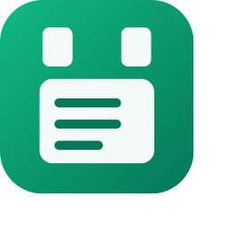
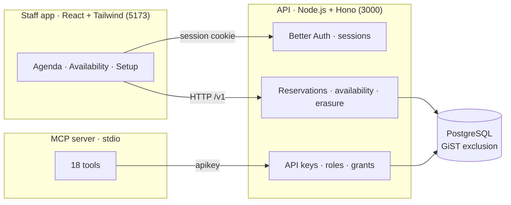
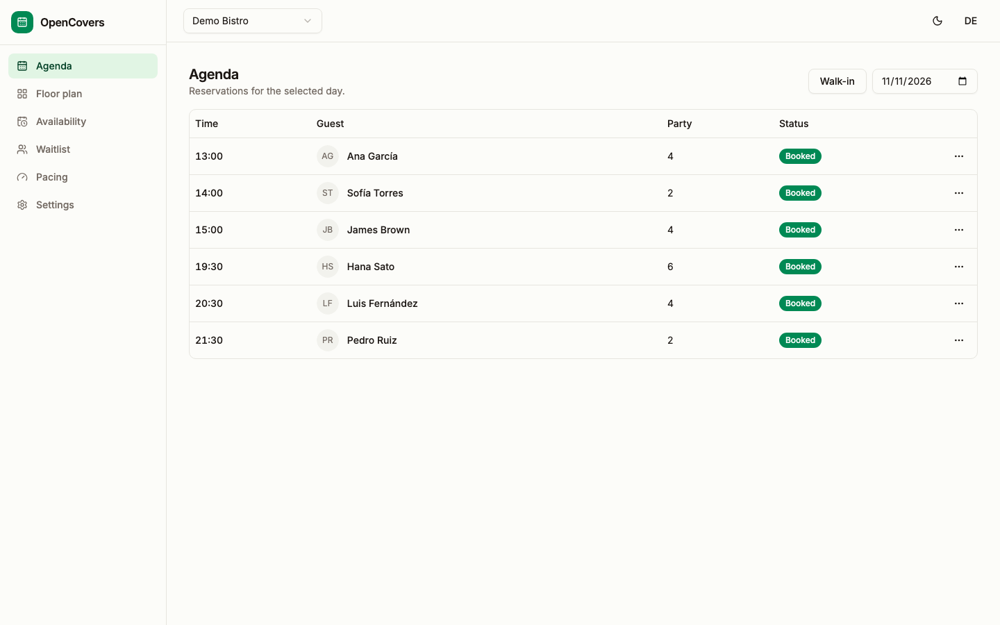
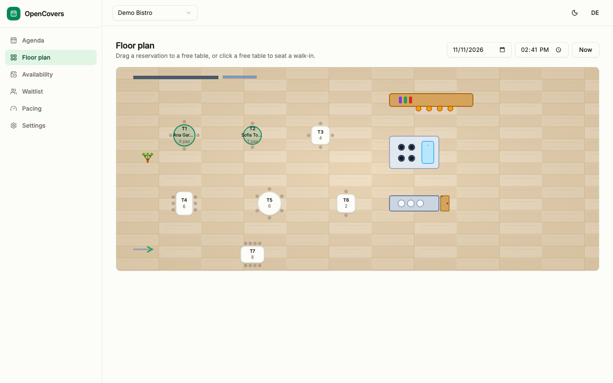
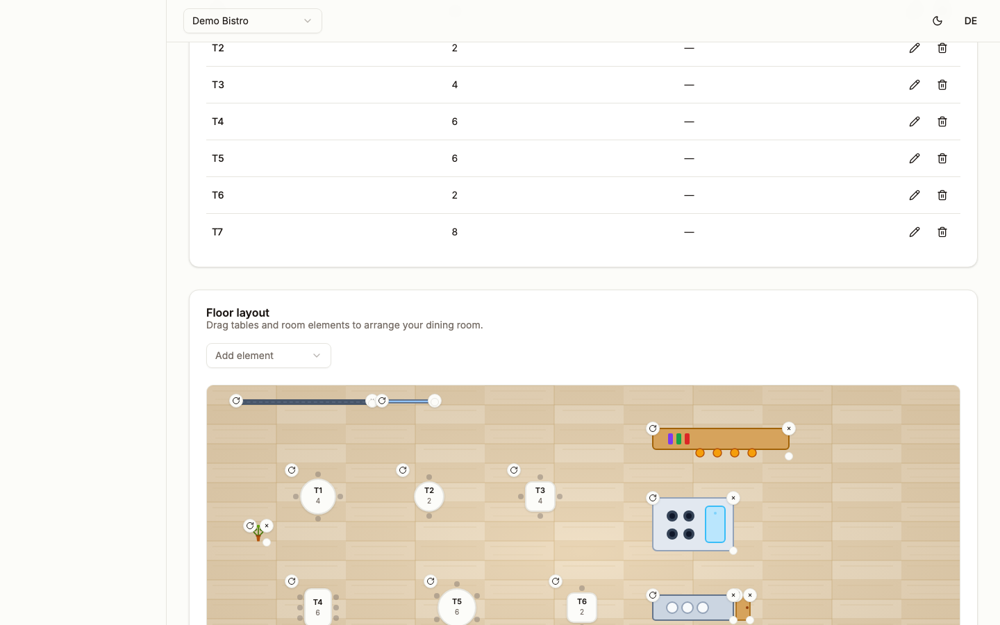

<div align="center">



# OpenCovers

**The open-source reservations engine for restaurants — availability, bookings, tables, and the event feed, with an API and an MCP server.**

<sub>OpenCovers is the working name. Trademark clearance is pending. Pre-alpha: it runs locally with tests, nothing is deployed yet.</sub>


[](LICENSE)


</div>

---

## Why

Most booking systems are tied to a CRM, a point-of-sale system, or a single vendor. A venue that changes its front end or its messaging provider risks losing its reservation book.

OpenCovers keeps the book independent. Any platform or AI agent reads availability, creates a booking, modifies it, or cancels it through the same contract — and the no-double-booking rule is enforced by the database, not by application code.

## Features

### 📅 Availability and booking

Read free time slots per service, create a booking against specific tables, and move, cancel, or seat it. Every write carries an idempotency key and a monotonic version.

### 🚫 No double bookings, guaranteed

A GiST exclusion constraint in PostgreSQL rejects overlapping table allocations. It holds for any number of concurrent writers — no application-level locking.

### 🔑 Humans and machines, both first-class

Staff sign in with Better Auth and get a per-venue role. Platforms and AI agents use scoped API keys (`read`/`write`) that a venue admin mints and revokes from the staff app.

### 🤖 An MCP server

The 18-tool catalog (`reservation.*`, `waitlist.*`, `venue.*`) is exposed over stdio, so Claude, Cursor, and other MCP hosts can operate a venue directly.

### 🧭 The room, covered

Walk-ins, a waitlist, zones, and automatic table assignment. The engine seats guests now, holds them in a queue, and assigns tables so platforms and agents never think about floor plans.

### 🪑 A visual floor plan

Drag tables and room elements onto a floor, snap them to a grid, rotate them, and resize them. Tables come in round, square, and rectangle shapes with chairs; room elements (bar, kitchen, wall, window, door, plant, counter, entrance) are drawn as architectural symbols on a wood floor — so the plan reads like a plan, not a list.

### 📧 Email confirmations

Confirmations, cancellations, and booking notices via Resend — one per reservation version, never duplicated. Each venue brings its own Resend account, and it's off until enabled.

### 🧹 Erasure built in

Erase guest data by contact or principal, and get back counts. Tombstones keep the hashes, never the personal values.

## How it works



## Quick start

You need Node.js 22 or newer, pnpm, and Docker.

```sh
git clone https://github.com/David-Cabeza/OpenCovers.git
cd OpenCovers
docker compose up -d   # PostgreSQL
pnpm install
pnpm db:migrate
pnpm dev               # API :3000 · staff app :5173 · site :5174
```

Open <http://localhost:5173>, sign up, and create a venue. The public site is at <http://localhost:5174>. The full guide is in [CONTRIBUTING.md](CONTRIBUTING.md).

To run the MCP server, see [apps/mcp](apps/mcp/README.md). Create an agent key from the staff app under **Setup → API keys**.

## Screenshots

The staff app in action — the agenda, the floor plan, and the floor editor.

<p align="center">
  
  
</p>
<p align="center">
  
</p>

## Repository layout

```
apps/api   the reservation engine and the HTTP API
apps/web   the staff app
apps/mcp   the MCP server
apps/site  the public website
docs/      the contract, ADRs, and requirements
```

## Design rules

- One transaction decides availability and booking.
- The database enforces the no-overlap rule. Application code does not.
- Every write carries an idempotency key and produces a monotonic version.
- A venue's data is isolated. A request for another venue returns not found.
- The engine takes a booking and honors a STOP without a memory platform.
- The engine stores the minimum guest data a booking needs.
- Erasure returns counts and keeps hashes, not personal values.
- The contract and the conformance cases come before the implementation.

## Deploy

The staff app and site deploy to Cloudflare Pages as static builds. The API ships as a Docker image (Node.js) and is being ported to Cloudflare Workers + Hyperdrive. See [docs/deploy.md](docs/deploy.md).

## Status

Pre-alpha. The engine, the staff screens, and the MCP server are implemented and tested locally — all 13 conformance cases pass. A deployment is prepared (Dockerfile and runbook) but not yet live. Email delivery is wired via Resend; the templates' legal text and consent basis are still pending review. See [ROADMAP.md](ROADMAP.md).

## Contributing

OpenCovers uses flags — scoped tasks with acceptance criteria, dependencies, and a size. Anyone can propose or claim one. Read [CONTRIBUTING.md](CONTRIBUTING.md) and the [flag issue form](.github/ISSUE_TEMPLATE/flag.yml).

## Governance and security

- [GOVERNANCE.md](GOVERNANCE.md) explains how decisions are made.
- [SECURITY.md](SECURITY.md) explains how to report a vulnerability.
- [CODE_OF_CONDUCT.md](CODE_OF_CONDUCT.md) applies to every project space.

## License

Apache-2.0. See [LICENSE](LICENSE).
